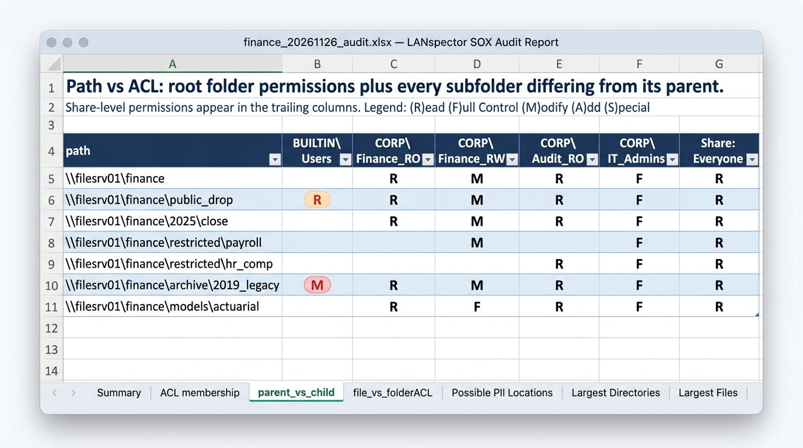

.. meta::
   :description: SOX, SOC 2, and ISO 27001 fileshare auditing guide: lossless parent-vs-child NTFS/POSIX ACL compression, file-vs-folder permission elevation detection, open shares, duplicates, and PII scanning.
   :keywords: sox fileshare audit, parent vs child acl compression, ntfs permission elevation, open shares report, everyone access audit, pii content scan, duplicate files md5, permission drift detection

SOX Auditing & Permission Analytics
===================================

Parent-vs-Child Permission Compression
--------------------------------------

:meth:`lanspector.reader.CrawlReader.parent_vs_child_report` compares every subfolder's
effective permissions against its immediate parent folder. Only the crawl root and folders
where permissions change are emitted, achieving lossless compression across massive trees.

Permission Codes
~~~~~~~~~~~~~~~~

* **R** — Read / Read & Execute
* **A** — Add files
* **M** — Modify / Change
* **S** — Special / custom ACL mask
* **F** — Full Control

Pass ``use_permission_hierarchy=True`` to collapse subordinate bits (e.g. ``MR`` becomes ``M``
and ``F`` dominates lower grants) so audits focus on effective privileges rather than raw DACL noise.

File-vs-Folder Elevated Access
~~~~~~~~~~~~~~~~~~~~~~~~~~~~~~

Unlike folder-only tools, LANspector compares individual file permissions against their
containing directory and surfaces any file granting *more* access than its parent folder in
the ``file_vs_folderACL`` sheet.

Multi-Crawl Drift Tracking
--------------------------

Store repeated crawls of the same fileshare inside a single SQLite database. Each crawl is
persisted in its own ``YYYYMMDDTHHMMSS`` table, allowing:

* :meth:`~lanspector.reader.CrawlReader.compare_crawls` — Added/removed files, directories, and permission diffs.
* :meth:`~lanspector.reader.CrawlReader.find_permission_changes` — Exact before/after ACL delta rows.
* :meth:`~lanspector.reader.CrawlReader.find_when_permissions_changed` — Full chronological drift log.
* :meth:`~lanspector.reader.CrawlReader.get_storage_growth_rate` — Byte growth across snapshots.

PII & Hygiene Detection
-----------------------

Enable ``detect_pii_content=True`` during crawling to scan ``.txt``, ``.csv``, ``.tsv``,
``.md``, ``.json``, and ``.xlsx`` files (via ``openpyxl``) for configured PII keywords, plus
optional NLTK proper-noun NER when ``lanspector[pii]`` is installed.
