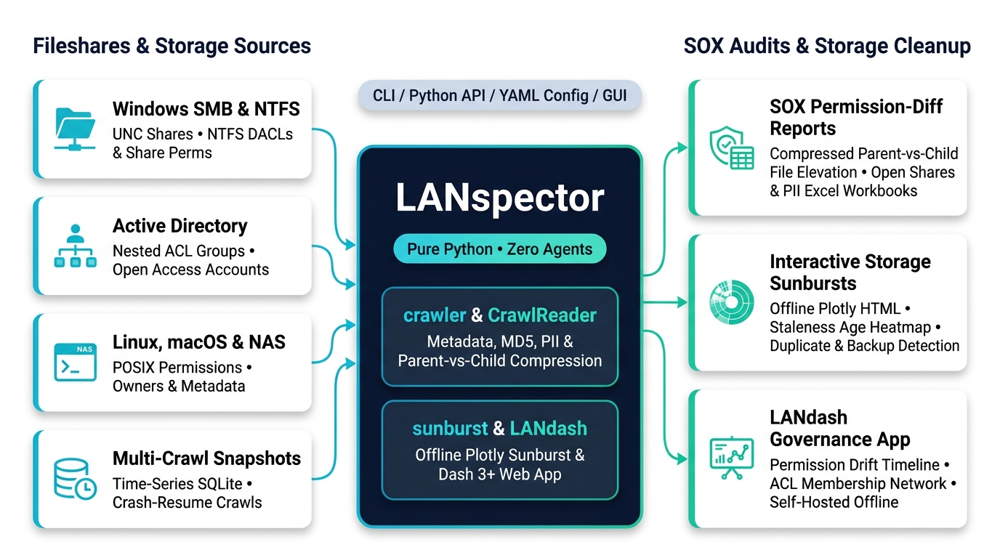

.. meta::
   :description: Cross-platform Windows & LAN fileshare auditor with compressed parent-vs-child SOX permission-diff Excel reports, Active Directory ACL analysis, PII scanning, interactive Plotly storage sunbursts, and an optional offline Dash web dashboard.
   :keywords: ntfs acl audit python, windows fileshare audit, sox fileshare permissions, soc 2 file access review, parent vs child acl diff, dumpsec alternative, varonis alternative, smb share permissions python, active directory group audit, pii scanner, plotly storage sunburst, lan cleanup, sqlite filesystem crawler

LANspector Documentation
========================

**LANspector** is an open-source Python library, CLI, and optional web dashboard
for auditing unstructured network fileshares and local filesystems:

1. **Harvest complete filesystem metadata & ACLs into SQLite**:
   Capture ``atime``, ``ctime``, ``mtime``, sizes, owners, MD5 digests, PII
   indicators, NTFS/SMB share DACLs (Windows), Active Directory group memberships
   (Windows), and POSIX permissions (Linux/macOS) into timestamped SQLite tables
   for longitudinal drift analysis.
2. **Generate losslessly compressed SOX permission-diff Excel workbooks**:
   The :meth:`~lanspector.reader.CrawlReader.parent_vs_child_report` algorithm
   compresses hundreds of thousands of folders down to only permission boundaries,
   while ``file_vs_folderACL`` catches individual files with broader access than
   their containing folder.
3. **Accelerate storage cleanup with interactive Plotly sunbursts & LANdash**:
   Export offline-ready interactive Plotly sunburst HTML charts colored by last-access
   staleness, or serve the optional ``lanspector[dashboard]`` multi-share web app.

Quick Start
-----------

.. code-block:: bash

   # Crawl a folder or Windows UNC share and generate an Excel audit workbook + sunburst chart
   lanspector crawl --path /srv/shares/finance --fout finance.db --summarize true --sunburst_html sunburst.html

   # Generate a full multi-sheet Excel audit workbook from one or more crawl databases
   lanspector report --databases '[finance.db]' --output finance_audit.xlsx

   # Export an interactive Plotly storage sunburst chart colored by staleness
   lanspector sunburst --database finance.db --output finance_sunburst.html --color_by age

Or from Python:

.. code-block:: python

   from lanspector import CrawlReader, crawl, export_sunburst_html, generate_fileshare_report

   crawl("/srv/shares/finance", fout="finance.db", scantype="fd", permissions=True)
   with CrawlReader("finance.db") as db:
       pvc = db.parent_vs_child_report(use_permission_hierarchy=True)
       generate_fileshare_report(db, "finance_audit.xlsx")
       export_sunburst_html(db, "finance_sunburst.html", color_by="age")

.. toctree::
   :maxdepth: 2
   :hidden:

   usage
   api/index
   consulting

Contents
--------

* :doc:`usage` — Installation, CLI subcommands, driver files, and Python API walkthrough.
* :doc:`auditing_guide` — Parent-vs-child ACL compression, SOX reports, PII detection, and drift tracking.
* :doc:`sunburst_dashboard_guide` — Standalone Plotly sunburst charts, LANdash ETL, and offline Dash deployment.
* :doc:`api/index` — Complete API reference across all LANspector modules.
* :doc:`consulting` — Enterprise consulting and custom audit automation support.

Indices and tables
==================

* :ref:`genindex`
* :ref:`modindex`
* :ref:`search`
