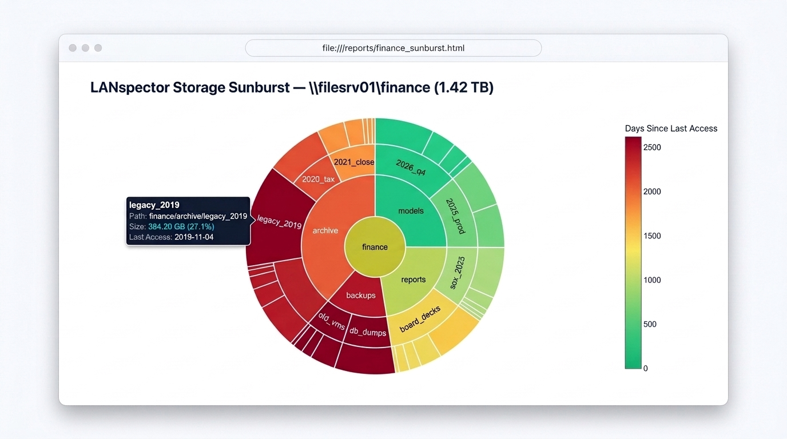

.. meta::
   :description: Interactive offline Plotly storage sunburst charts colored by last-access staleness and the self-hosted Dash 3+ LANdash multi-share governance web dashboard.
   :keywords: plotly storage sunburst, disk space visualizer python, stale data cleanup heatmap, landash dashboard, dash fileshare governance, acl membership network graph, air-gapped plotly html

Storage Sunbursts & LANdash Web App
===================================

Standalone Interactive Plotly Sunburst
--------------------------------------

Generate a self-contained HTML sunburst chart from any crawl database without running a web server:

.. code-block:: bash

   lanspector sunburst --database finance.db --output finance_sunburst.html \
       --color_by age --include_plotlyjs inline

With ``--include_plotlyjs inline`` (the default), the generated HTML embeds Plotly.js directly so
it opens cleanly on air-gapped or restricted corporate networks. Click any ring to zoom in, hover
for exact byte sizes and last-access dates, and use the ``age`` color scale to highlight large,
stale folders ripe for archiving or cleanup.

Optional LANdash Multi-Share Dashboard
--------------------------------------

Install the ``[dashboard]`` extra to aggregate multiple crawl databases over time into an
interactive Dash 3+ application:

.. code-block:: bash

   pip install "lanspector[dashboard]"
   # 1. Aggregate one or more crawl databases into a LANdash SQLite store
   lanspector dashboard-prep --databases '[finance.db, hr.db]' --dashboard_db landash.sqlite

   # 2. Serve the interactive web dashboard locally
   lanspector dashboard --dashboard_db landash.sqlite --host 127.0.0.1 --port 8050

LANdash configures ``serve_locally=True`` and uses native Plotly ``go.Sunburst`` and ``go.Scatter``
network graphs—requiring no external CDN access or custom React packages.
